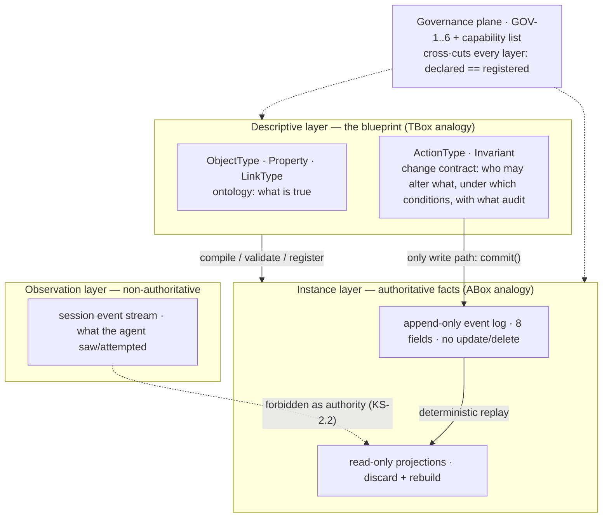
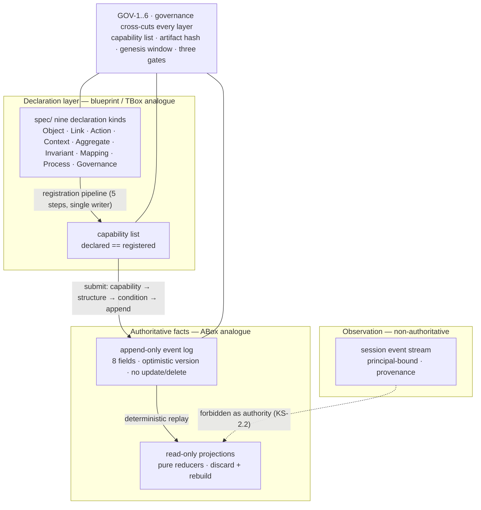

# AosKeel

> **Language / 语言**: **English (default)** · [简体中文](docs/README.zh-CN.md)
>
> **Sections 1–9 of this page and of the Chinese edition are line-for-line counterparts**: same order, same facts, same numbers, different language. The Chinese edition additionally carries a full source-tree map in Appendix A. Where the two ever disagree on a normative fact, the frozen Chinese canonical specification wins; see the [language and authority matrix](docs/README.md#language--authority).

**A verifiable, 0→1 scaffold for ontology-based Agent systems — specification-driven, governance-built-in, and machine-checkable.**

AosKeel implements the *AOS: Ontology-Based Agent System Development Specification* v2.0.0. It is closer to `npm create vue` than to a runtime product: you instantiate a source tree, declare your domain, and let the compiler and gates decide whether the system is allowed to start. This page gives you the theory and a working entry point; the [full guide](#6-guided-learning) goes deeper. The frozen canonical spec is a Chinese text; English readers can start from the [non-normative English overview](docs/aos-spec.en-overview.md) (a navigation aid only — it does not translate or replace the canonical).

**Three version numbers, do not conflate them**: software `0.3.0` (`pyproject.toml`, git tag `v0.3.0`), canonical specification `v2.0.0` (frozen, hash-registered), and the whitepaper/strategy documents `v1.0` (document editions).

---

## 1. Why an LLM needs an ontology

A language model is widely read but structurally naive: it produces plausible text, not constrained assertions. An ontology supplies the missing structure — an explicit, formal definition of the concepts, relations, properties and rules of a domain.

> A database stores `user_id` and `product_id`. An ontology must say what a **User** is, what a **Purchase** means, and that **payment succeeded** is a precondition for **shipping**.

| Failure mode of LLM-only systems | Ontology mechanism | Where AosKeel enforces it |
|---|---|---|
| Confident hallucination | Assertions must be made through declared actions | Unregistered capabilities have no write path (`INV-1`, `INV-13`) |
| Business rules live in prose | Rules compiled into machine-checkable constraints | `submission_criteria` → Check AST + restricted Boolean profile (`KS-7.1`) |
| Semantic drift between spec and code | One semantic source of truth, continuously reconciled | `declared == registered` bijection (`KS-7.2`) |
| "What did it know at the time?" is unanswerable | Every evaluation and change is recorded | Interpreter audit + 8-field events + decision references (`KS-3.3`, `KS-2.5`) |
| Permissions live in the prompt | Capability surface is a strict subset of the list | Rejection before the store is reached (`P-10`, `INV-4`) |

**Lineage — and what AosKeel deliberately is not.** Four traditions meet here; none of them alone is AosKeel:

| Tradition | Contribution | AosKeel's position |
|---|---|---|
| Description logics / OWL (Baader et al., 2003) | TBox/ABox, classes, axioms | Teaching analogy only — no DL reasoner, no RDF/SPARQL store |
| Action formalisms — PDDL (McDermott et al., 1998), situation calculus (Reiter, 2001), event calculus (Kowalski & Sergot, 1986) | Preconditions, effects, state transition | `ActionType` compiles preconditions into Check AST and writes effects through the kernel; no planner |
| Deontic logic (von Wright, 1951; Jones & Carmo, 1993) | Permission, obligation, norm | Governance declarations and the capability list turn permission into a startup-time gate, not an inferred conclusion |
| Production graph ontologies (Palantir-style object/link/action; industrial practice) | Explicit object models at scale | Engineering shape borrowed; the governance layer and mechanical checkpoints are AosKeel's addition |

AosKeel is a **governable ontology scaffold**, not a reasoner, planner, or triple store. Its claim is deliberately narrow and testable: a declared action cannot reach the event store without passing structural checks, conditions evaluated over materialized state, permission evidence, and an append-only audit trail. This mapping is executable: `aos cq` runs the ten competency questions of [06 · Formal semantics](docs/guide/06-formal-semantics.md#41-能力问题驱动建模最容易被跳过的一步) against the kernel.

---

## 2. Ontology in three minutes: TBox, ABox, and the AOS increment

```
Knowledge graph = ontology (schema / TBox) + instance data (ABox)
```

- **TBox (terminological box)** — the blueprint: which classes exist (`Patient`, `Order`), which properties describe them, which relations hold (`is-a`, `part-of`), and which axioms must be true ("every order has exactly one customer").
- **ABox (assertion box)** — the building: individuals and facts, traditionally expressed as triples `(subject, predicate, object)`, e.g. `(ZhangSan, takes, Aspirin)`.

| Classical concept | AOS term | Concrete artifact |
|---|---|---|
| Class | `ObjectType` | `spec/ontology/objects/Contract.object.yaml` |
| Data / object property | `Property` | `properties` in the object declaration; `decision_relevant` adds audit semantics |
| Relation | `LinkType` (structural link) | `spec/ontology/links/same_as.link.yaml` — zero business semantics, system-written |
| Axiom / rule | Invariant triple + restricted Boolean function (declaration + doc view; runtime detector is instance-side, see §9) | `spec/invariants/*.yaml`, `src/interpreter/` |
| Individual | State projected from the event log | `src/kernel/projection.py` |
| Triple assertion | **Event with version, actor and time** | `src/kernel/store.py` — 8 fields, append-only |

**The decisive difference.** Classical ontology describes *what is true*. AOS adds a fourth element to the tuple:

```
ObjectType / Property / LinkType / ActionType        ← T01 four-element tuple
ContextType / AggregateType / Mapping / ProcessType  ← T02 four constructs
```

`ActionType` is a declarative state-change contract: parameters, submission criteria, permissions, side effects and audit requirements. With it, the ontology stops being purely descriptive and starts **gating changes to the world** — who may change what, under which conditions, and with what trace. That is the shift from a descriptive ontology to a **governable ontology**. OWL can express "approved contracts are contracts"; it cannot express "only a contract steward may approve, and never above one million".

Two further AOS-specific dimensions have no classical counterpart: an **observation layer** (the session event stream, physically separated from authoritative facts) and **governance as a startup condition** (the capability list must be complete before the kernel starts; legitimacy is recorded, never manufactured).

> TBox/ABox is a **teaching analogy** here. AosKeel does not use RDF triples, SPARQL or a DL reasoner. Facts are immutable events; queries are rebuildable projections. [06 · Formal semantics](docs/guide/06-formal-semantics.md) explains the mapping and its exact limits.

### The mental model in one diagram

The three-layer picture below is the navigation map for the whole project. It is an **inductive view** of the clauses, not a new normative layer — authority stays with [aos-spec.md](docs/aos-spec.md) and the [02 · Architecture](docs/guide/02-architecture.md) derivation.



Read the layers as follows: the **ontology / descriptive layer** (ObjectType, Property, LinkType) says what is true; `ActionType` is the element inside that layer which turns a descriptive ontology into a **governable** one — it compiles "who may change what, under which conditions, and with what trace" into an executable contract. The **governance plane** (GOV-1..6 plus the capability list) cuts across all layers and is a startup condition. The **instance layer** holds the only authoritative facts (immutable events + rebuildable projections), and the physically separated **observation layer** may never stand in as authority. This is why an LLM can propose candidates but cannot write canonical facts: every write must traverse `ActionType` and the governance plane.

---

## 3. Architecture at a glance



Five axioms drive the whole design: **AX-1** events are the source of truth and actions are the only change; **AX-2** probabilistic mechanisms may only propose; **AX-3** three separations (type/instance, declaration/implementation, platform contract/context boundary); **AX-4** closed-loop auditability; **AX-5** schema is data. From these come 30 kernel semantics, 17 patterns, 13 global invariants, a 5-stage boot sequence, 6 governance clauses, and 33 verification points. See [02 · Architecture](docs/guide/02-architecture.md).

---

## 4. A five-step runtime loop

1. **Declare** the domain in `spec/` (nine YAML kinds, governance included — never edit generated code as the source of truth).
2. **Register**: the five-step pipeline compiles structural checks and conditions, validates links/contexts, and publishes the capability list. A failure blocks startup.
3. **Submit**: `Kernel.submit()` runs capability + role-evidence check → structural validation → conditional evaluation → append. The appended event carries the action's *declared* state effects (T24 副作用 — status is written by the declaration, never asserted by the caller). Declared roles must be presented (`roles=…`); missing evidence = refused before the store is touched (P-10 / INV-4, fail-closed). A version conflict reruns the *entire* evaluation, not just the append.
4. **Check**: three gates — structural fingerprint → cryptographic hash → `declared == registered`. The cryptographic gate compares two hash domains: the frozen canonical text and the `spec/` declaration digest (GOV-2.3-DECL); they are still one gate. Any failure exits non-zero.
5. **Release**: a fail-closed gate chains the wired test suites and skeleton byte check; only then is `dist/RELEASE-MANIFEST.json` written.

---

## 5. Smallest runnable example

```powershell
pip install -e .                       # installs pyyaml + pytest (pytest runs aos test / release)
aos verify                             # three gates
aos init my-org-system                 # instantiate the source tree
```

```python
# Run from the template root (or an initialized instance root).
import sys
from pathlib import Path
sys.path.insert(0, str(Path.cwd())); sys.path.insert(0, str(Path.cwd() / "src"))

from kernel.registration import compile_all
from kernel.store import EventStore
from kernel.session import SessionChannel
from kernel.pipeline import Kernel
from kernel.errors import ConditionalRejected

kernel = Kernel(EventStore(), SessionChannel(), compile_all())

# Entities enter the authoritative projection through a declared action;
# status is written by the action's declared effects (T24), never self-reported.
kernel.submit("RegisterContract", {"contract_id": "C-1", "amount": 500000},
              "alice", roles=("contract_steward",))

ev = kernel.submit("ApproveContract", {"contract_id": "C-1"}, "alice",
                   roles=("contract_steward",))
print(ev.event_type, ev.payload["status"])   # ApproveContract@1 approved

try:
    kernel.submit("ApproveContract", {"contract_id": "C-1"}, "alice",
                  roles=("contract_steward",))
except ConditionalRejected:
    print("refused — no event appended; audit retained")
```

In an initialized instance use `python src/cli/main.py <command>`, **not** `aos`. Both entry points dispatch through the same `main()`, but their anchors differ: the `aos` console script resolves `ROOT = Path(__file__).resolve().parents[2]` — the template root it was installed from, independent of the current working directory — whereas `python src/cli/main.py` anchors to the source tree you are standing in. Inside an instance, using `aos` would operate on the template, not on your instance. Full step-by-step output, including conflict re-evaluation and projection rebuild, is in [07 · Kernel walkthrough](docs/guide/07-kernel-walkthrough.md).

The instance-side lifecycle, from instantiation to release (the Chinese edition §5 carries the same sequence):

```powershell
pip install -e .                              # pyyaml + pytest (pytest drives aos test / release)
aos init my-org-system --depth standard       # instantiate + capability profile (dependency-expanded)
cd my-org-system
# from here on: python src/cli/main.py ... (see the anchor note above)
python src/cli/main.py profile                # resolve capability profile → topological generation order
python src/cli/main.py bootstrap --stage 0    # BOOT-0: artifact hash registration + first three-gate run
python src/cli/main.py verify                 # structural → cryptographic → registration
python -m pytest -q tests                     # consistency + forbidden bijection + interpreter negatives
python src/cli/main.py bootstrap --stage 1 --appointment-ref <external-credential>  # real-world evidence required
python src/cli/main.py draft requirements.txt --name r1
python src/cli/main.py draft promote spec/drafts/draft-r1.yaml --proposal-ref SPEC-2026-021
python src/cli/main.py generate               # declarations → skeleton (governance → CQRS → OAuth 2.1 → frontend)
python src/cli/main.py release                # fail-closed gate → dist/RELEASE-MANIFEST.json
```

BOOT-2/3 (governance workflow, Identity Context acceptance) are deliberately **not implemented** at template level and return a refusal; they are instance-side world events (GOV-1). See the [runbook](docs/RUNBOOK.md).

---

## 6. Guided learning

The guide ships in Chinese to preserve clause-level terminology exactly; it is copied into every instance by `aos init`. It is **informative**, not normative — clause IDs and the frozen canonical text remain authoritative. English readers can follow the code, tables and clause IDs, use the two language editions of this README side by side, or start from the [non-normative English overview](docs/aos-spec.en-overview.md) of the clause map.

| # | Document | What you will learn |
|---|---|---|
| — | [Guide index](docs/guide/README.md) | Reader-specific paths and three honest boundaries |
| 01 | [Foundations](docs/guide/01-foundations.md) | Ontology, TBox/ABox, blueprint/building, Palantir-style comparison, the four-element tuple |
| 02 | [Architecture](docs/guide/02-architecture.md) | AX→KS→P→INV→BOOT→GOV→VER derivation, four event streams, accident-based pattern justification |
| 03 | [Implementation](docs/guide/03-implementation.md) | Registration pipeline, SC compiler, submission pipeline, restricted interpreter, upcasting, gates |
| 04 | [Tutorial](docs/guide/04-tutorial.md) | install → init → BOOT-0 → draft/promote → generate → submit → test/release, with real outputs |
| 05 | [Reference](docs/guide/05-reference.md) | 26 commands (21 top-level + 5 subcommands), file map, T01–T26, VER-1..33 wiring, exceptions, FAQ |
| 06 | [Formal semantics](docs/guide/06-formal-semantics.md) | Description logic, open vs closed world, engineering method, OWL↔AOS translation limits |
| 07 | [Kernel walkthrough](docs/guide/07-kernel-walkthrough.md) | Executable Python: rejection paths, full re-evaluation, projections, decision audit |
| 08 | [Enterprise app guide](docs/guide/08-enterprise-app-guide.md) | The full build-out: modeling → AI drafting & promotion → generation → external ingestion → agent wiring → release → what you must build yourself |
| 09 | [Structure & trajectory](docs/guide/09-structure-and-trajectory.md) | Project structure map, clause-ID lookup, the standard development trajectory (incl. permission model and stuck-point table) |
| — | [Visual overview](docs/guide/index.html) | HTML concept map: generic concept → AOS clause → code artifact |

---

## 7. Command cheat sheet — 26 commands (21 top-level + 5 subcommands)

| Command | Purpose | Failure behaviour |
|---|---|---|
| `aos init <dir> [--depth D] [--cap ID]` | Instantiate + capability profile (dependency-expanded) | Existing target → refuse; invalid depth/capability → fail fast before instantiation |
| `aos profile` | Resolve and validate the capability profile | Missing anchor → `PROFILE-FAIL` with pending list; cycle / unknown capability → refuse |
| `aos verify` | Three chained gates | Any failure → exit 1 |
| `aos cq [list\|run] [CQ-n ...] [--domain D]` | Run the ten competency questions against the kernel; `--domain` runs instance-defined sets | Missing question / unregistered answerer / failed assertion → exit 1 |
| `aos register <version>` | GOV-2.3 artifact registration (idempotent for the same hash) | Drift → refuse (GOV-3) |
| `aos bootstrap --stage N [--dry-run]` | BOOT-0..3; stage 1 requires a real external appointment reference | Out-of-order stage → refuse; stages 2/3 are instance-side → refuse |
| `aos test [--suite S]` | Run suites wired in `config/verification.yaml` | Suite failure / missing wired path → exit 1 |
| `aos spec fingerprint` | Standalone structural-layer check | Discrepancy → exit 1 |
| `aos spec digest` | Read-only view of the declaration digest and its registration state | No writes |
| `aos spec register-declarations <v> [--proposal-ref ...]` | GOV-2.3-DECL append-only declaration registration (frozen canon untouched) | Later drift without a proposal reference → refuse |
| `aos spec version <v> --proposal-ref ...` | GOV-3 version channel (append-only) | Missing `--proposal-ref` → refuse |
| `aos generate [--force]` | Declarations → code skeleton (governance → CQRS → OAuth 2.1 → frontend guard tables); hand edits block silent overwrite | Missing anchor → `CODEGEN-REFUSED`; byte drift → refuse |
| `aos release` | Fail-closed release gate → `dist/RELEASE-MANIFEST.json` | Any failed gate → no artifact |
| `aos draft <file> [--name N]` | Requirements DSL → compiler-gated draft | Not fully green → nothing written |
| `aos draft promote <f> --proposal-ref ...` | Promote a draft to canonical (single writer) | Existing target → refuse; GOV-3 channel mandatory |
| `aos import-db` | Legacy schema → ontology draft (DDL or sqlite DSN; meta-structure only) | Translation failure → fail-closed, no tables dropped; table without primary key → refuse |
| `aos import-data` | Legacy rows → genesis-event drafts (each row through the full evaluation chain) | Dirty rows → full problem list, fail-closed |
| `aos extract` | Semantic extraction: source code / docs → ontology draft (same three gates; builtin deterministic rules, pluggable LLM adapter via stdout-YAML contract; candidates never facts) | Adapter crash / bad schema / no candidates → loud refusal, zero writes |
| `aos shadow` | Offline dual-run reconciliation: legacy rows ↔ new-system events | Divergence → `DIVERGED` with a diff detail (feeds `review`) |
| `aos shadow-online` | Online dual-run reconciliation: consumes deployment-side probe NDJSON (probe contract in tool header; fail-closed on bad lines; probes are instance-side) | Bad line → fail-closed, zero silence; empty record → `PROBE-EMPTY` |
| `aos review` | Read-only adjudication list (anchors / draft candidates / governance audit) | Advisory only; promotion suggestions require `--proposal-ref` |
| `aos manual [--out F]` | Domain manual: nine declaration kinds → readable doc (derived view, not a source of truth) | Derived view; defaults to stdout |
| `aos impact <target>` | Reverse-reference impact graph (declaration name / spec path / `ObjectType.prop`) | Unresolvable target → `IMPACT-UNKNOWN`, exit 1 |
| `aos audit export <events.jsonl>` | Chain `audit_id` JSONL export (read-only derived artifact) | Missing path / missing event log → refuse |
| `aos metrics` | Gate-history metrics from `dist/gate-history.jsonl` | Empty ledger → `METRICS-EMPTY` hint (exit 0) |
| `tools/console.py` | WEB governance console shell over the same CLI (whitelisted commands; signing commands excluded) | Outside whitelist / governance-signing command → 403 refusal |

Three guardrails apply across the whole command surface: (1) `bootstrap --stage 1` requires a real `--appointment-ref` — the template never synthesizes a founding appointment (GOV-1); (2) an instance carries a copy of the canonical text plus its registry entry ID, and copy hash == registered hash — any mutation yields `FROZEN-TEXT-MUTATED` (INV-12); (3) every draft channel (`draft` / `import-db` / `import-data` / `extract`) writes only into `spec/drafts/` or `data-drafts/` — **a draft is not a fact**, promotion requires a GOV-1 proposal, and credentials (DSNs, keys) never land on disk (locked by a test).

---

## 8. Legacy migration: the strangler pipeline

Old systems enter through the same gates — imported material is always a **draft**, never a fact:

```powershell
aos init <dir> --depth standard        # 1. instantiate + capability breadth
aos import-db --ddl legacy.sql         # 2. structure extraction (schema → ontology draft)
aos review                             # 3. adjudication list (candidates / governance audit)
aos draft promote ... --proposal-ref   # 4. human promotion (GOV-1 proposal mandatory)
aos generate                           # 5. new-system code (governance → CQRS → OAuth 2.1)
aos import-data --dsn ... --map M      # 6. data as genesis events (every row through the evaluation chain)
aos shadow --dsn ... --map M           # 7. offline dual-run: rows ↔ events semantic parity
python tools/console.py                # 8. WEB console shell over the same CLI (whitelist, fail-closed)
```

Data migration is **event replay, not table copy**: each legacy row must pass the new system's full evaluation chain (registration → role evidence → structural → conditional → store); dirty rows are refused, never laundered into the event stream. OAuth 2.1 is not a plugin but a **projection of the governance plane** — token claims are rendered from the duty matrix, and presenting an undeclared role is refused.

The theory behind this — the five-layer model (concept/structure/constraint/behavior/mapping) with the governance plane cross-cutting every layer, and the ten engineering disciplines (deterministic generation with LLM-as-drafter, three-gate drafts, fail-closed everywhere, credentials never on disk) — is in the [whitepaper](docs/WHITEPAPER.md).

---

## 9. Honest boundaries (read before adopting)

- **No proof of compliance.** `mandatory` clauses require human execution on a running system, with evidence, judge and signer. The template never marks them passed for you.
- **No manufactured legitimacy.** Stewards and founding appointments are world events; the template records them, never synthesizes them (GOV-1). BOOT-2/3 are not implemented at template level and return a refusal.
- **Source-tree delivery.** The wheel does not carry `docs/spec/config` and the startup self-check refuses it (verified, INTEGRITY-20) — see the wheel boundary note below.
- **In-memory event store.** `EventStore` is a dict: no persistence across process restarts. `kernel/filestore.py` ships a FileStore **reference implementation** (JSONL append + replay, single-writer process model); durable multi-process storage remains an instance-side duty under the same protocol.
- **wheel is a build artifact, not a deliverable.** `pip wheel .` builds `aos_keel-*.whl` (src/ + tools/ only; the `aos` console script works), but it ships **without** docs/spec/config — running it outside a source tree prints an explicit `REFUSED` (machine-guarded, INTEGRITY-20). The only supported runtime form is the source tree with `pip install -e .`, so the canonical declarations stay versioned next to the code.
- **The console is a shell, and an offline one.** `tools/console.py` drives the CLI via subprocess with a fail-closed command whitelist; governance-signing commands (release/register/bootstrap) are excluded by design, and `aos shadow` is offline reconciliation — online dual-run traffic comparison is a deployment-stage duty.
- **Structural fingerprint is weak by design.** It checks clause counts and anchors; the cryptographic hash layer is the strong guarantee.
- **Declarations without runtime consumers are instance-side.** `spec/invariants/*.yaml` `declaration.expression` is a normative and documentation view (rendered by `tools/domain_manual.py`); registration only verifies `repair_binding`, and the `Detector` API (`kernel/detector.py`) takes a Python callable. Wiring a detector and opening the gate is an instance-side duty — `config/verification.yaml` keeps `invariants: {gate: false}` as the machine marker. Likewise `dry_run: required` compiles to a flag and implies `audit: required`, but `Kernel.submit` never reads it: `kernel/dryrun.py` is a library API for pre-submit rehearsal, with no `aos dryrun` command.
- **Roles are enforced, contexts are environmental.** `Kernel.submit` rejects absent required roles from evidence; `permissions.contexts` is checked for reference integrity at registration and injected into the conditional environment as a snapshot. The canonical capability-face rule (`Agent 权限 = 角色 × 所在上下文`, INV-4) is a capability-configuration / projection duty of the instance, not an automatic context gate in the template.
- **The hash domain is narrow by design.** Frozen bytes cover `docs/aos-spec.md` + `docs/SPEC-FINGERPRINT.md`, plus a separate declared-digest over `spec/**/*.yaml`. Guides, whitepaper, strategy, review notes and these READMEs are informative and outside both domains; see the language and authority matrix.
- **Probes and LLM bindings are instance-side.** The kernel ships the reconciliation protocol (`aos shadow-online` consumes probe NDJSON) and the extraction adapter contract (`aos extract --extractor`); the interception probe and any real LLM call belong to the deployment, so the kernel has zero deployment and zero LLM dependencies.
- **Byte-exact, fail-closed everywhere.** All writes are UTF-8 + LF; `.gitattributes * -text` disables newline conversion, so external CRLF edits are rejected by `generate` / `release` as byte drift. Wiring paths declared in `config/verification.yaml` but missing on disk block `aos test` and `aos release` (no silent downgrade).
- **Language and authority.** The frozen canonical (`docs/aos-spec.md` v2.0.0), `SPEC-FINGERPRINT.md`, the nine-part guide, the whitepaper, positioning, runbook and registry are Chinese. English companions are explicitly scoped: this README and its Chinese counterpart are bilingual editions of one page, `STRATEGY.en.md` is the English edition of the Chinese strategy paper, and `aos-spec.en-overview.md` is a **non-normative navigation aid** that translates neither clauses nor normative prose. On any conflict, the Chinese canonical wins.

**What the template gives, and what it refuses to give** (same table in Chinese edition §9):

| Gives | Refuses |
|---|---|
| All `auto` VER items in CI · five-step registration pipeline (single writer) · BOOT sequence scaffold · six mandatory-item checklists · three gates · bijection assertion | A compliance certificate. A `mandatory` "passed" can only come from human execution on a running system with evidence + judge + signer (VER-28 red-team, interpreter purity, base immutability). |

**Engineering boundaries at a glance:**

| Boundary | Fact | Instance-side duty |
|---|---|---|
| Delivery form | Source tree + `pip install -e .`; wheel is a build artifact, `REFUSED` outside a source tree (INTEGRITY-20) | A production wheel would require reworking canonical-data packaging and ROOT resolution |
| Event store | `EventStore` = in-memory dict; `FileStore` = single-process JSONL reference implementation | Database implementing the same protocol (read-only streams · `commit` as sole write surface · append-only audit) |
| Probes / LLM | Only protocols and adapter contracts in the kernel | Implement the probe and bind an LLM inside your own adapter |
| Structural fingerprint | Clause counts + first/last anchors only; full-text hash is the strong layer | None — this is a documented trade-off, not a gap |
| Declaration consumers | `invariant.expression` is a doc view; `dry_run` is a rehearsal flag; `invariants: {gate: false}` | Register a detector callable and open the gate in the instance; call `kernel.dryrun.dryrun()` before submit |
| Roles / contexts | roles enforced from evidence at submit; contexts = reference check + env snapshot | Enforce capability-face (INV-4) via instance capability config / projection |
| Hash domain | canon two files + `spec/**/*.yaml` declared digest | Guides / whitepaper / strategy are informative, outside the frozen domain |
| BOOT-2/3 | Scaffolds and checklists only; `bootstrap --stage 2/3` refuses | Governance workflow and Identity Context acceptance are world events (GOV-1) |
| Mandatory items | Machine-checkable parts of VER-24/26/27/28/29 are wired into suites; VER-20 stays purely manual | Human execution + evidence / judge / signer — wiring ≠ a human signature |
| Byte precision | UTF-8 + LF; `* -text` | CRLF edits show up as byte drift and are refused |

### Two distribution artifacts (ADR-001, incremental)

`packages/` was added without replacing the root wheel: `aoskeel-kernel` is a `pip install`-able pure-logic wheel (kernel / interpreter / generated / agents), and `aoskeel-template` is a source-tree sdist carrying docs/spec/config for `aos init`. The kernel wheel needs `AOSKEEL_ROOT` pointing at a template root before `registration` / `session` can read `config/` and `spec/`; unset, behaviour is byte-for-byte the source-tree behaviour. `aos init` still copies from the local source tree — no network fetch. See [ADR-001](docs/adr/ADR-001-dual-distribution.md) and the two package READMEs.

## Appendix A · Source tree map (condensed)

The Chinese edition's Appendix A carries the full file-by-file map; the essentials:

```
README.md / docs/README.zh-CN.md   bilingual editions, §1–§9 mirrored
docs/aos-spec.md                   frozen canonical v2.0.0 (hash-registered)
docs/SPEC-FINGERPRINT.md           clause fingerprint list (GOV-2.4)
docs/ARTIFACT-REGISTRY.md          append-only artifact registry (GOV-2.3)
docs/guide/                        nine-part informative guide (copied into every instance)
spec/                              nine declaration kinds + meta schema + profile + CQ sets (business semantics source)
config/                            capabilities.yaml (capability list) + verification.yaml (VER wiring)
src/kernel/ src/interpreter/       registration, submission, append-only store, restricted interpreters
src/agents/ src/generated/         agent capability surface + generated skeletons (byte-drift guarded)
src/cli/main.py                    command table (26 command surfaces)
tools/                             gates, codegen, migration, extraction, console, metrics
packages/                          kernel wheel + template sdist (ADR-001)
bootstrap/checklists/              evidence templates for mandatory items
tests/                             conformance / negative / golden / genesis / replay / redteam
```

Note that `docs/TEMPLATE-LOCK.md` and `docs/DOMAIN-MANUAL.md` are generated **inside an instance** by `aos init`; they are not template-root files. `spec/` holds declarative inputs, not the canonical specification — the normative source of truth is `docs/aos-spec.md`.

Full detail: [docs/README.md](docs/README.md) (index + language/authority matrix) · [简体中文](docs/README.zh-CN.md) · [Positioning](docs/POSITIONING.md) · [Whitepaper](docs/WHITEPAPER.md) · [Strategy (中文)](docs/STRATEGY.md) / [(English)](docs/STRATEGY.en.md) · [Runbook](docs/RUNBOOK.md) · [English overview, non-normative](docs/aos-spec.en-overview.md) · [Canonical specification](docs/aos-spec.md).
