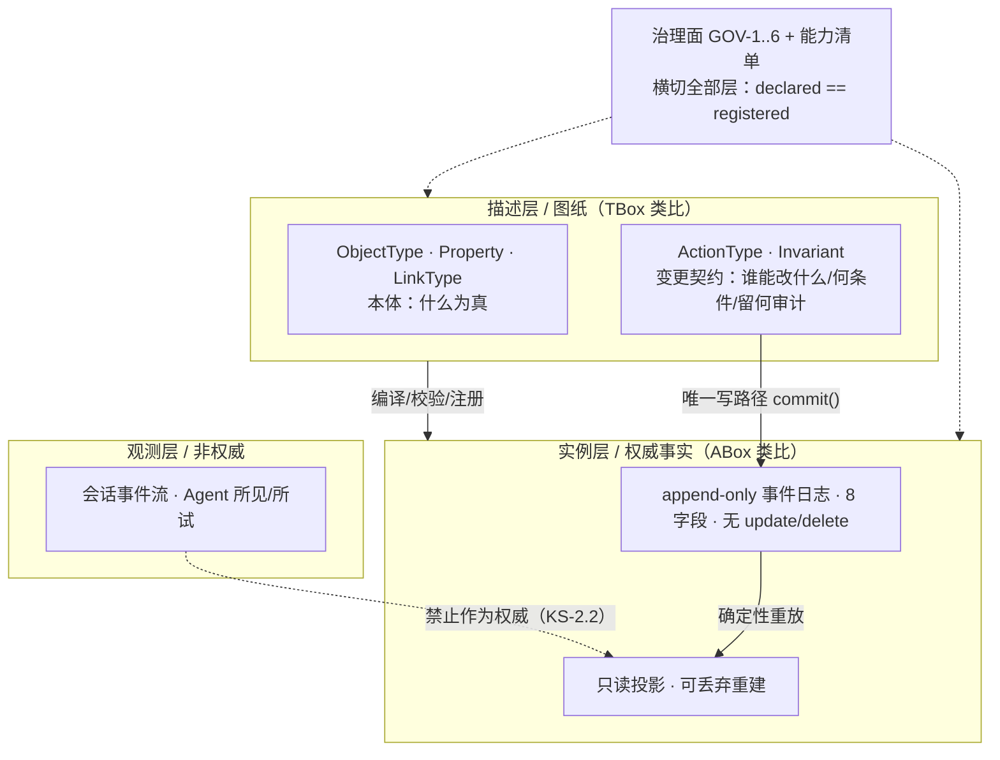
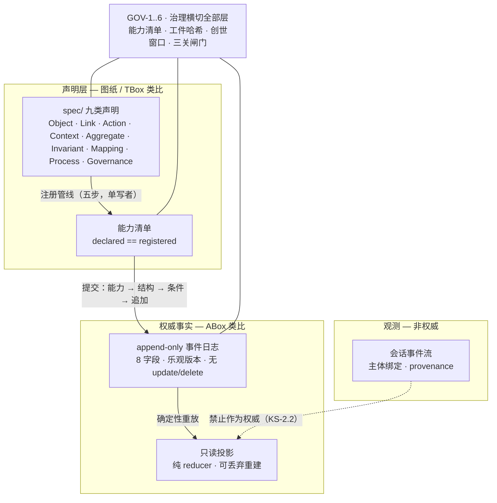

# AosKeel —— 基于本体论的 Agent 系统开发模板（软件 v0.3.0 / 规范 v2.1.1）

> **语言 / Language**：**简体中文** · [English (default)](../README.md)
>
> **本页 §1–§9 与仓库根英文首屏逐节对应**：章节顺序、事实、数字、边界一致，只是语言不同；附录 A 是本版独有的完整模板树（英文版为精简版）。中文 §7 标题按仓库口径守卫固定为 `## CLI …`，其位置即英文 §7。两者对规范性事实若有分歧，以中文冻结正典为准；效力与语言矩阵见 [docs/README.md](README.md#语言与效力矩阵)。
>
> **三个版本号不要混用**：软件 `0.3.0`（`pyproject.toml`、git tag `v0.3.0`）、规范 `v2.1.1`（冻结、哈希登记）、白皮书与战略稿 `v1.0`（文档版次）。
>
> 正典规范（[aos-spec.md](aos-spec.md)）为中文冻结文本，未作翻译；`docs/` 下其余规范类文档（SPEC-FINGERPRINT / ARTIFACT-REGISTRY / WHITEPAPER / POSITIONING / RUNBOOK）与九篇指南同样保持中文。英文读者可看[英文概览](aos-spec.en-overview.md)——它是**非规范导航件**，不翻译正典、不进哈希域，发生冲突以中文正典为准。

**定位**：规范驱动开发是方法论，AI 软件工厂是组织与流程载体，本体论架构是让前两者在语义层面真正"可执行"的基础设施——本项目是这层基础设施在**模板层**的一个完整、可校验的具体实现（条款级对照与全链路缺口地图见 [POSITIONING.md](POSITIONING.md)）。对标 `npm create vue` / VS 项目模板：从 0 到 1 实例化一个基于本体论的、治理内建的企业级 Agent 系统；**不是运行时产品**——实例化源码树、声明领域，再由编译器与闸门决定系统是否允许启动。

需区分两个"真源"：**规范条款的真源**是冻结正典 `docs/aos-spec.md`（哈希登记，`AOS-ART-003`；附录 R/S 为信息性增量）；**业务语义的真源**是 `spec/` 九类声明（YAML，另有独立的声明摘要哈希域）。`spec/` 是被编译的输入，不是规范文本本身。

正典规范：《AOS：基于本体论的 Agent 系统开发规范》v2.1.1（[docs/aos-spec.md](aos-spec.md)，登记条目见 [docs/ARTIFACT-REGISTRY.md](ARTIFACT-REGISTRY.md)）。

---

## 1. 为什么 LLM 需要本体

**AI 本体论是对某领域概念、关系、属性与规则所做的显式、形式化定义。** 语言模型广读而结构天真：它产出的是"看似合理的文本"，不是受约束的断言。数据库只存 `user_id` / `product_id`；本体则要定义"用户"是什么、"购买"意味着什么，以及"支付成功"是"发货"的前置规则。AosKeel 把这套骨架变成机器可校验的契约，让 Agent 的断言与行动有据可依、有规可循。

| LLM 单独使用时的失效模式 | 本体机制 | AosKeel 的强制点 |
|---|---|---|
| 自信的幻觉 | 断言必须经声明的动作作出 | 未注册能力没有写路径（`INV-1`、`INV-13`） |
| 业务规则活在散文里 | 规则编译成机器可校验约束 | `submission_criteria` → Check AST + 受限布尔档（`KS-7.1`） |
| 规范与代码语义漂移 | 单一语义真相源，持续对账 | `declared == registered` 双射（`KS-7.2`） |
| "它当时知道什么"无法回答 | 每次求值与变更都留痕 | 解释器审计 + 八字段事件 + 决策引用（`KS-3.3`、`KS-2.5`） |
| 权限写在 prompt 里 | 能力面是清单的严格子集 | 触碰存储前拒绝（`P-10`、`INV-4`） |

**学术谱系与诚实边界。** 四条传统在此交汇，AosKeel 不等于其中任何一条：

| 传统 | 贡献 | AosKeel 的立场 |
|---|---|---|
| 描述逻辑 / OWL（Baader et al., 2003） | TBox/ABox、类、公理 | 仅作教学类比；无 DL 推理机、无 RDF/SPARQL 三元组库 |
| 动作形式化——PDDL（McDermott et al., 1998）、情境演算（Reiter, 2001）、事件演算（Kowalski & Sergot, 1986） | 前置条件、效果、状态变迁 | `ActionType` 把前置条件编译为 Check AST、效果由内核写入；无规划器 |
| 道义逻辑（von Wright, 1951；Jones & Carmo, 1993） | 许可、义务、规范 | 治理声明 + 能力清单把许可变成启动期可执行门禁，而非推理结论 |
| 生产级图本体（Palantir 风格 object/link/action，工业实践） | 显式对象模型的可扩展性 | 借用工程形态；治理层与机械核对点是 AosKeel 的增量 |

AosKeel 是**治理性本体脚手架**，不是推理机、规划器或三元组库。其主张刻意收窄且可检验：声明的动作未经结构检查、物化状态上的条件求值、权限证据与 append-only 审计，不得触达事件存储。该映射是可执行的——`aos cq` 会针对内核运行[06 · 形式语义](guide/06-formal-semantics.md#41-能力问题驱动建模最容易被跳过的一步)的十张能力问题。

---

## 2. 三分钟本体：TBox、ABox 与 AOS 增量

```
知识图谱 = 本体（图纸 / TBox） + 实例数据（大楼 / ABox）
```

- **TBox（术语盒）**：哪些类存在（`Patient`、`Order`）、哪些属性描述它们、哪些关系成立（`is-a`、`part-of`）、哪些公理必须为真（"每个订单恰有一个客户"）。
- **ABox（断言盒）**：个体与事实，传统上写作三元组 `(主语, 谓词, 宾语)`，如 `(张三, 服用, 阿司匹林)`。

| 经典概念 | AOS 构件 | 实际落点 |
|---|---|---|
| 类 Class | `ObjectType` | `spec/ontology/objects/*.object.yaml` |
| 数据 / 对象属性 | `Property`（可标 `decision_relevant`） | 对象声明 |
| 关系 Relation | `LinkType`——结构性、零业务语义 | `spec/ontology/links/*.link.yaml` |
| 公理 / 规则 | 不变量三元组 + 受限布尔函数（声明与文档视图；运行时检测器属实例侧，见 §9） | `spec/invariants/`、`src/interpreter/` |
| 个体 / 三元组 | 事件投影状态 / 八字段不可变事件 | `src/kernel/projection.py`、`src/kernel/store.py` |
| *（无对应）* | `ActionType`、能力清单、会话流、创世窗口 | `spec/ontology/actions/`、`config/capabilities.yaml`、`src/kernel/session.py`、`src/kernel/genesis.py` |

**决定性差异。** 经典本体描述"什么为真"；AOS 在元组中加入第四元素：

```
ObjectType / Property / LinkType / ActionType        ← T01 四元组
ContextType / AggregateType / Mapping / ProcessType  ← T02 四构造
```

`ActionType` 是声明式状态变更契约：参数、提交条件、权限、副作用与审计要求。有了它，本体不再只是描述性的，而是开始**对世界的变更设闸**——谁能改什么、在什么条件下、留下什么轨迹。这是从描述性本体到**治理性本体**的跃迁。OWL 能表达"已批准的合同是合同"，不能表达"只有合同管理员可批准，且金额不得超过一百万"。

另有两个经典本体没有的维度：非权威的**观测层**（会话事件流，与权威事实物理隔离），以及作为**启动条件的治理**（能力清单必须在内核启动前完备；正当性只记录、不制造）。

> TBox / ABox 在此是**教学类比**。AosKeel 不用 RDF 三元组、不用 SPARQL、不含 DL 推理机；事实是不可变事件，查询是可重建投影。[06 · 形式语义](guide/06-formal-semantics.md)给出映射及其精确边界。

### 一张图看懂三层模型（全书导航图）

下图是对条款的**归纳视图**，不是新增规范层次——效力仍以[正典](aos-spec.md)与[02 体系逻辑](guide/02-architecture.md)的推导链为准：



三层这样读：**本体 / 描述层**（ObjectType、Property、LinkType）说"什么为真"；`ActionType` 是这一层里把描述性本体变成**治理性本体**的构件——它把"谁能改、什么条件下、留什么审计"编译为可执行契约。**治理面**（GOV-1..6 加能力清单）横切全部层，且是启动条件。**实例层**持有唯一权威事实（不可变事件 + 可重建投影）；物理隔离的**观测层**永不得冒充权威。这正是 LLM 只能提候选、不能写正典的原因：每次写入都必须穿过 `ActionType` 与治理面。

---

## 3. 架构总览



五条公理驱动整体设计：**AX-1** 事件是真相源、动作是唯一变更；**AX-2** 概率机制只能提候选；**AX-3** 三重分离（类型/实例、声明/实现、平台契约/上下文边界）；**AX-4** 闭环可审计；**AX-5** schema 即数据。由此派生 30 条内核语义、17 条模式、13 条全局不变量、5 阶段启动序列、6 条治理条款与 33 个验证点。见 [02 · 体系逻辑](guide/02-architecture.md)。

---

## 4. 五步运行循环

1. **声明**：在 `spec/` 写九类 YAML（含治理面声明）；生成的永不是真源。
2. **注册**：五步管线编译结构检查与条件、校验链接/上下文、发布能力清单；任一失败阻断启动。
3. **提交**：`Kernel.submit()` 走"能力 + 角色证据 → 结构校验 → 条件求值 → 追加"。追加的事件携带动作的*声明式*状态效果（T24 副作用——status 由声明写入，绝不由调用方自报）。声明的角色必须出示（`roles=…`），缺证据在触碰存储前拒绝（P-10 / INV-4，fail-closed）。版本冲突会重跑**整条**求值链，而非只重试追加。
4. **核对**：三关——结构指纹 → 密码学哈希 → `declared == registered`；密码学层同时比对两个哈希域（冻结正典文本与 `spec/` 声明摘要，GOV-2.3-DECL），仍属同一关。任一失败非零退出。
5. **签发**：fail-closed 发布闸门串联已布线测试套件与骨架字节核对；全绿才写 `dist/RELEASE-MANIFEST.json`。

---

## 5. 最小可运行示例与快速开始

```powershell
pip install -e .                       # 安装 pyyaml + pytest（pytest 驱动 aos test / release）
aos verify                             # 三关
aos init my-org-system                 # 实例化源码树
```

```python
# 在模板根或已初始化实例根运行
import sys
from pathlib import Path
sys.path.insert(0, str(Path.cwd())); sys.path.insert(0, str(Path.cwd() / "src"))

from kernel.registration import compile_all
from kernel.store import EventStore
from kernel.session import SessionChannel
from kernel.pipeline import Kernel
from kernel.errors import ConditionalRejected

kernel = Kernel(EventStore(), SessionChannel(), compile_all())

# 实体经声明的动作进入权威投影；status 由动作的声明式效果（T24）写入，不自报。
kernel.submit("RegisterContract", {"contract_id": "C-1", "amount": 500000},
              "alice", roles=("contract_steward",))

ev = kernel.submit("ApproveContract", {"contract_id": "C-1"}, "alice",
                   roles=("contract_steward",))
print(ev.event_type, ev.payload["status"])   # ApproveContract@1 approved

try:
    kernel.submit("ApproveContract", {"contract_id": "C-1"}, "alice",
                  roles=("contract_steward",))
except ConditionalRejected:
    print("refused — no event appended; audit retained")
```

**进入实例后必须用 `python src/cli/main.py <command>`，不要用 `aos`。** 两种入口都经 `main()` 分发、argv 缺省取 `sys.argv[1:]`，但锚点不同：`aos` 控制台脚本锚定安装它的模板根（`ROOT = Path(__file__).resolve().parents[2]`，与 cwd 无关）；`python src/cli/main.py` / `python -m src.cli.main` 锚定当前所在源码树。在实例内用 `aos`，操作的是模板而不是实例。`pytest` 是声明的运行时依赖（`aos test` / `aos release` 要执行布线套件），缺失时明确报 `PYTEST-MISSING` 拒绝，不伪装成"套件失败"。

实例侧完整生命周期（英文版 §5 为同一序列）：

```powershell
pip install -e .                              # 安装 pyyaml + pytest
aos init my-org-system --depth standard       # 实例化 + 能力画像（依赖自动展开；拒绝覆盖已存在目标）
cd my-org-system
# —— 重要：进入实例后用 python src/cli/main.py，不要用 aos ——
python src/cli/main.py profile                # 解析能力画像：拓扑生成序（治理 → cqrs → oauth → 前端）
python src/cli/main.py bootstrap --stage 0    # BOOT-0：工件哈希登记 + 三关首跑
python src/cli/main.py verify                 # 三关：结构(指纹) → 密码学(哈希) → 注册(declared==registered)
python -m pytest -q tests                     # 一致性 + forbidden 双射 + 解释器负向集
python src/cli/main.py bootstrap --stage 1 --appointment-ref <外部凭据>   # BOOT-1 创制任命（强制真实凭据）
python src/cli/main.py draft requirements.txt --name r1   # 需求 DSL → 草案（编译把关，未全绿不落盘）
python src/cli/main.py draft promote spec/drafts/draft-r1.yaml --proposal-ref SPEC-2026-021   # 晋升正典
python src/cli/main.py generate               # 声明 → 代码骨架（治理→CQRS→OAuth2.1→前端守卫；手改检测）
python src/cli/main.py release                # 发布闸门（fail-closed）→ dist/RELEASE-MANIFEST.json
```

BOOT-2/3（治理工作流、Identity Context 验收）在模板层**明示未实装**，`bootstrap --stage 2/3` 返回拒绝；它们属实例侧世界事件（GOV-1）。详见 [RUNBOOK.md](RUNBOOK.md)。含冲突重求值与投影重建的逐步输出见 [07 · 内核实操](guide/07-kernel-walkthrough.md)。

---

## 6. 理论与教程导览

完整的**九篇指南**为中文撰写（保证条款级术语零损失），随 `aos init` 复制到每个实例；它们是**信息性**材料，不产生规范条款。英文读者可对照代码、表格与条款编号，或看[英文概览](aos-spec.en-overview.md)的条款地图；也可从 [GitHub 首屏入口](../README.md#6-guided-learning) 进入。

| 指南 | 覆盖内容 |
|---|---|
| [索引](guide/README.md) | 按读者分流的路径与三条诚实边界 |
| [01 基础概念](guide/01-foundations.md) | 本体论、TBox/ABox、蓝图-建筑、Palantir 风格对照、四元组 |
| [02 体系逻辑](guide/02-architecture.md) | AX→KS→P→INV→BOOT→GOV→VER 推导链、四条事件流、事故反证模式 |
| [03 实现方法](guide/03-implementation.md) | 注册、SC 编译、提交管线、受限解释器、升级、闸门 |
| [04 实操教程](guide/04-tutorial.md) | install → init → BOOT-0 → draft/promote → generate → 提交 → test/release（实测输出） |
| [05 速查手册](guide/05-reference.md) | 命令面 26（21 顶层 + 5 子命令）、文件地图、T01–T26、VER-1..33 布线、异常、FAQ |
| [06 形式语义](guide/06-formal-semantics.md) | 描述逻辑、开放/封闭世界、本体工程方法、OWL↔AOS 翻译边界 |
| [07 内核实操](guide/07-kernel-walkthrough.md) | 可运行 Python：拒绝路径、完整重求值、投影、决策审计 |
| [08 企业应用构建指南](guide/08-enterprise-app-guide.md) | 完整构建路径：建模 → AI 起草与晋升 → 生成 → 外部接入 → Agent 装配 → 签发 → 实例侧自建清单 |
| [09 结构与开发轨迹](guide/09-structure-and-trajectory.md) | 项目结构地图、条款编号速查、标准开发轨迹（含权限模型与卡点排查表） |
| [可视化总览](guide/index.html) | HTML 概念图：通用概念 → AOS 条款 → 代码构件 |

---

## CLI 26 命令面（21 顶层 + 5 子命令）与护栏 ×3（对应英文 §7）

| 命令 | 语义 | 失败行为 |
|---|---|---|
| `init <dir> [--depth D] [--cap ID] [--no-cap ID]` | 实例化 + 能力画像（依赖自动展开；三档 depth 预设） | 目标已存在 → 拒绝（重铺须 `--force`）；非法 depth/能力 → 实例化前 fail-fast |
| `profile` | 解析能力画像：依赖展开 + 拓扑生成序 + 锚点核对 | 锚点缺失 → `PROFILE-FAIL` 带待声明清单；环/未知能力 → 拒绝 |
| `verify` | 三关串联 | 任一失败 → exit 1 |
| `cq [list\|run] [CQ-n ...] [--domain D]` | 能力问题可执行验收（contract 域十张冻结清单）；`--domain` 跑实例自定义域 | 缺题 / 回答者未注册 / 断言失败 → exit 1 |
| `register <version>` | GOV-2.3 登记 | 同哈希幂等；漂移 → 拒绝（GOV-3） |
| `bootstrap --stage N` | BOOT-0..3；`--dry-run` 只跑检查表 | 阶段乱序 → 拒绝；2/3 属实例侧 |
| `test [--suite S]` | 按 verification.yaml 分组 | 套件失败 / 布线路径缺失 → exit 1 |
| `spec fingerprint` | 独立结构层核对 | 报缺 → exit 1 |
| `spec digest` | 只读查看 spec/ 声明摘要与登记状态 | 不写入 |
| `spec register-declarations <v> [--proposal-ref ...]` | GOV-2.3-DECL 声明摘要登记（append-only；不动冻结正典） | 首次直接登记；后续漂移缺提案引用 → 拒绝 |
| `spec version <v>` | GOV-3 版本通道（append-only） | 缺 `--proposal-ref` → 拒绝 |
| `generate [--force]` | 声明 → 代码骨架（Profile 门控：治理→CQRS→OAuth2.1→前端守卫；字节级零漂移） | 锚点缺失 → `CODEGEN-REFUSED`；手改漂移 → 拒绝静默覆盖 |
| `release` | 发布闸门（fail-closed） | 任一关失败 → 不出制品 |
| `draft <file>` | 需求 DSL → 草案（编译把关） | 未全绿 → 不落盘 |
| `draft promote <f>` | 草案晋升正典（GOV-1 提案强制） | 目标已存在 → 拒绝；走 GOV-3 |
| `import-db --ddl F / --dsn URI` | 老库元结构 → 本体草案（方言翻译大声报告） | 翻译失败 fail-closed 不丢表；无主键表拒绝（AX-4） |
| `import-data --dsn URI --map F` | 老库行 → 创世事件草案（逐行过完整求值链；迁移器不发明事件） | 脏行 → 完整问题清单 fail-closed；`--skip-failed` 大声跳过 |
| `extract <file> [--extractor script]` | 语义提取：源码/文档 → 草案（同一三段闸，闸门与来源无关） | 适配器崩溃/坏 schema/无候选 → 大声拒绝零落盘 |
| `shadow --dsn URI --map F` | 影子对账（离线双跑）：行 ↔ 事件语义等价 | 分歧 → `DIVERGED` 带差异明细（进 review 裁决） |
| `shadow-online <probes.ndjson>` | 在线双跑对账协议（探针 NDJSON 契约；探针属部署侧） | 坏行 → fail-closed 零静默；空记录 → `PROBE-EMPTY` |
| `review` | 只读裁决清单（锚点 roadmap / 草案候选 / 治理对账前置） | 只读咨询；晋升建议强制 `--proposal-ref` |
| `manual [--out F]` | 领域说明书：九类声明 → 可读文档（人读 + LLM 上下文注入） | 派生视图；缺省打印到 stdout |
| `impact <target>` | 变更影响分析：声明名 / spec 路径 / `ObjectType.prop` → 反向引用图（含治理授权边；事前咨询） | 目标不可解析 → `IMPACT-UNKNOWN` exit 1 |
| `audit export <events.jsonl>` | 统一审计台账：追加证据 + 评估审计 + 决策引用 → 链式 `audit_id` JSONL（只读派生件） | 缺路径 / 事件日志不存在 → 拒绝 |
| `metrics` | 闸门度量（`dist/gate-history.jsonl`）：运行次数、通过率、各关失败、漂移计数、连续通过 | 空台账 → `METRICS-EMPTY` 提示（exit 0） |
| `tools/console.py`（独立进程） | WEB 治理控制台壳：subprocess 驱动上述命令（白名单分级） | 白名单外 / 治理签署类 → 403 拒绝（中文提示） |

护栏一：`bootstrap --stage 1` 强制 `--appointment-ref`——拒绝合成创制任命（GOV-1）。

护栏二：实例携带规范副本 + 登记条目 ID，副本哈希 = 登记哈希，改动即 `FROZEN-TEXT-MUTATED`（INV-12）。

护栏三：所有草案通道（draft / import-db / import-data / extract）产物只进 `spec/drafts/` 或 `data-drafts/`——**草案不是事实**，晋升必须走 GOV-1 提案；凭据（连接串/密钥）永不落盘（有测试锁定）。

---

## 8. 旧系统迁徙：绞杀者管线

旧系统从同一组闸门进入——导入素材永远是**草案**，不是事实：

```powershell
aos init <dir> --depth standard        # 1. 实例化 + 能力广度
aos import-db --ddl legacy.sql         # 2. 结构提取（schema → 本体草案）
aos review                             # 3. 裁决清单（候选 / 治理审计）
aos draft promote ... --proposal-ref   # 4. 人工晋升（GOV-1 提案强制）
aos generate                           # 5. 新系统代码（治理 → CQRS → OAuth 2.1）
aos import-data --dsn ... --map M      # 6. 数据作创世事件（每行过完整求值链）
aos shadow --dsn ... --map M           # 7. 离线双跑：行 ↔ 事件语义等价
python tools/console.py                # 8. WEB 控制台壳（白名单，fail-closed）
```

数据迁徙是**事件重放，不是表拷贝**：每行老数据都必须过新系统的完整求值链（注册 → 角色证据 → 结构 → 条件 → 存储）；脏行被拒绝，绝不被洗白进事件流。`aos extract` 提供源码/文档的语义提取契约（确定性参考提取器 + 可插拔 LLM 适配器），`aos shadow-online` 提供在线双跑对账协议——但探针组件与真实 LLM 绑定都在实例侧。OAuth 2.1 不是插件，而是**治理面的投影**：token claims 由职责矩阵渲染，出示未声明的角色即被拒绝。

背后的理论——五层模型（概念/结构/约束/行为/映射）加治理面横切，以及十条工程纪律（确定性生成且 LLM 只产草案、三段闸、处处 fail-closed、凭据不落盘）——见[白皮书](WHITEPAPER.md)与[战略稿（中文）](STRATEGY.md) / [(English)](STRATEGY.en.md)。

---

## 9. 诚实边界（采用前先读）

- **不给合规证明。** `mandatory` 条款须人工在运行系统上执行并留档（evidence + judge + signer）；模板永不代你打勾。
- **不制造正当性。** steward 与创制任命是世界事件，模板只记录、不合成（GOV-1）；BOOT-2/3 模板层未实装，命令返回拒绝。
- **以源码树交付。** wheel 不含 `docs/spec/config`，启动自检拒绝它（机器验证 INTEGRITY-20）——见下方工程边界表。
- **事件存储是内存态。** `EventStore` 为 dict，进程退出即失；`kernel/filestore.py` 提供 FileStore **持久化参考实现**（JSONL 追加 + 重放，单写进程模型），持久化的多进程存储属实例侧职责，须实现同一协议。
- **wheel 是构建产物，不是交付物。** `pip wheel .` 可构建 `aos_keel-*.whl`（含 src/ + tools/ 与 `aos` console script），但不含 docs/spec/config；脱离源码树运行输出明确 `REFUSED`（INTEGRITY-20）。唯一受支持的运行形态是源码树 + `pip install -e .`，让正典声明与代码同版本管理。
- **控制台是壳，且离线的那个。** `tools/console.py` 经 subprocess 驱动 CLI，命令白名单 fail-closed，治理签署类命令（release/register/bootstrap）刻意不提供；`aos shadow` 是离线对账，在线双跑流量比对属部署阶段职责。
- **结构指纹刻意弱校验。** 只核对条数与首尾锚点；强保证来自密码学全文哈希层。
- **无运行时消费者的声明字段属实例侧。** `spec/invariants/*.yaml` 的 `declaration.expression` 是规范表达与文档视图（`tools/domain_manual.py` 渲染），注册期只核 `repair_binding`；`Detector` 接口（`kernel/detector.py`）接收 Python callable。接入检测器并开闸是实例侧义务——`config/verification.yaml` 保持 `invariants: {gate: false}` 作为机器标记。同理 `dry_run: required` 编译为布尔标志并蕴含 `audit: required`，但 `Kernel.submit` 从不读取：`kernel/dryrun.py` 是提交前演练的库级 API，CLI 无 `aos dryrun` 命令。
- **角色强制、上下文仅供环境。** `Kernel.submit` 从证据强制 required roles；`permissions.contexts` 只做注册期引用完整性检查，并作为快照注入条件求值环境。正典的能力面规则（`Agent 权限 = 角色 × 所在上下文`，INV-4）由实例侧能力配置／投影兑现，模板层不设自动上下文门禁。
- **哈希域刻意收窄。** 冻结字节仅 `docs/aos-spec.md` + `docs/SPEC-FINGERPRINT.md`，另有独立的 `spec/**/*.yaml` 声明摘要。指南、白皮书、战略稿、评审记录与两版 README 均为信息性文档，不在两域内；见语言与效力矩阵。
- **探针与 LLM 绑定在实例侧。** 内核只给对账协议（`aos shadow-online` 消费探针 NDJSON）与提取适配器契约（`aos extract --extractor`）；拦流探针与真实 LLM 调用属部署侧，内核零部署环境依赖、零 LLM 依赖。
- **字节精确、处处 fail-closed。** 所有写入点为 UTF-8 + LF，`.gitattributes * -text` 禁止换行转换，外部改成 CRLF 时 `generate` / `release` 以字节漂移拒绝；`config/verification.yaml` 声明了 `path` 而文件不存在 → `aos test` 与 `aos release` **阻断**，不再静默降级。
- **语言与效力。** 冻结正典（`docs/aos-spec.md` v2.1.1）、指纹清单、九篇指南、白皮书、定位、Runbook 与登记表均为中文。英文配套件各有明确边界：根 README 与本页是同一页的双语版，`STRATEGY.en.md` 是中文战略稿的英文版，`aos-spec.en-overview.md` 是**非规范导航件**（既不翻译条款，也不翻译规范性正文）。任何冲突以中文正典为准。

**这个模板给什么、不给什么：**

| 给 | 不给 |
|---|---|
| VER 全部 `auto` 项的 CI 兑现 · 注册期管线（五步，单写者）· BOOT 序列脚手架 · 〔强〕项检查表（6 份）· 三关核对（结构/密码学/注册）· 双射断言 | 合规证明。〔强〕项的"已通过"只能来自运行系统上的人工执行（检查表留档：evidence + judge + signer）；基座不可修改的证明 = VER-28 红队演练；解释器纯性 = 解释器实现的正确性；正当性（steward、创制任命）是世界事件——本模板只记录，不制造（GOV-1）。 |

**运行形态与工程边界：**

| 边界 | 事实 | 代价 / 实例侧职责 |
|---|---|---|
| 交付形态 | 模板以**源码树**交付：`pip install -e .`（之后用 `aos ...`）或 `python -m src.cli.main`。**wheel 是构建产物非交付物**（已机器验证 INTEGRITY-20） | 生产 wheel 交付须重构正典数据打包与 ROOT 解析（有意保持源码树交付：正典声明与代码同版本管理） |
| 事件存储 | `EventStore` 为**纯内存** dict；`kernel/filestore.py` 提供 FileStore 持久化参考实现（JSONL 追加 + 启动重放，单写进程模型） | 生产多进程部署须以数据库实现同一协议（streams 只读 · `commit` 唯一写面 · audit 只增），并自行证明 append-only 与审计持久性 |
| 探针与 LLM 在实例侧 | 在线影子流量的拦流探针与 LLM 服务绑定都是实例侧职责；内核只提供对账协议与提取契约 | 按部署环境实现探针组件；LLM 调用写进自己的适配器——内核零部署环境依赖、零 LLM 依赖 |
| 结构层指纹 | 核对"条数 + 首锚 + 末锚"，**不校验中间条款内容**；强保证来自密码学层全文哈希（GOV-2.3） | 中间条款被改而首尾不变 → 结构层 PASS，靠哈希层拦截；这是附录 F 清单定义的取舍 |
| 声明字段消费者 | `invariant.expression` 为文档视图；`dry_run` 为演练标志；`invariants: {gate: false}` | 实例侧注册 detector callable 并开闸；提交前自行调用 `kernel.dryrun.dryrun()` |
| 角色 / 上下文 | 提交时从证据强制 roles；contexts 仅引用检查 + 环境快照 | 实例侧以能力配置／投影兑现能力面（INV-4） |
| 哈希域 | 正典两文件 + `spec/**/*.yaml` 声明摘要 | 指南／白皮书／战略稿为信息性，不在冻结域 |
| BOOT-2/3 | 模板只给脚手架与检查表，`bootstrap --stage 2/3` 返回拒绝 | 治理工作流与 Identity Context 验收属实例侧世界事件（GOV-1） |
| 〔强〕项 | VER-24/26/27/28/29 的机器可判部分**已布线进测试套件**（replay/redteam/完备性壳）；VER-20（创制验收）保持纯人工 | 人工执行 + evidence / judge / signer 留档不变——接线 ≠ 替代人签，模板不伪装通过 |
| 字节精确 | 所有写入点为 UTF-8 + LF 字节写入；`.gitattributes * -text` 禁止换行转换 | 生成物/登记/清单被外部工具改成 CRLF 时，`generate`/`release` 以字节级漂移拒绝 |

### 双分发工件（ADR-001，增量）

`packages/` 为增量新增，未替换根 wheel：`aoskeel-kernel` 是可 `pip install` 的纯逻辑 wheel（kernel / interpreter / generated / agents），`aoskeel-template` 是携带 docs/spec/config 的源码树 sdist，作 `aos init` 的模板源。kernel wheel 装进 site-packages 后须设置 `AOSKEEL_ROOT` 指向一份模板根，`registration` / `session` 才能读到 `config/` 与 `spec/`；未设置时行为与源码树内运行逐字一致（零回归）。`aos init` 仍从本地源码树复制，未引入网络拉取。见 [ADR-001](adr/ADR-001-dual-distribution.md) 与两个包的 README。

布线件 `config/verification.yaml` 由 `tools/wiring.py` 统一用 pyyaml 解析；`integrity_paths` 段只登记回归守卫测试的执行路径，**不构成新 VER 条款**（v2.1.1 冻结条款集仍为 VER-1..33，指纹清单与登记哈希均未改动）。

完整细节：[docs/README.md](README.md)（索引 + 语言与效力矩阵）· [English](../README.md) · [Positioning](POSITIONING.md) · [Whitepaper](WHITEPAPER.md) · [Runbook](RUNBOOK.md) · [英文概览（非规范）](aos-spec.en-overview.md) · [正典规范](aos-spec.md)。

---

## 附录 A · 模板树（完整版；英文版为精简版）

```
README.md                      仓库根首屏入口（英文默认、完整版 = 唯一英文真源）
docs/README.md                 文档索引（薄指针 + 语言与效力矩阵）
docs/README.zh-CN.md           本文件（简体中文完整版，§1–§9 与英文版逐节对应）
docs/aos-spec.md               正典规范 v2.1.1（冻结，哈希登记 AOS-ART-003；附录 R/S 为信息性）
docs/aos-spec.en-overview.md   英文概览（非规范导航件；不进哈希域、不翻译条款）
docs/SPEC-FINGERPRINT.md       条款指纹清单（正典之二，GOV-2.4）
docs/ARTIFACT-REGISTRY.md      工件登记（append-only，GOV-2.3；实例自行重新登记）
docs/WHITEPAPER.md             白皮书：五层模型 + 治理面横切 + 十条工程纪律 + 迁徙管线
docs/POSITIONING.md            项目定位：规范驱动开发 / AI 软件工厂 / 本体论三者对照与缺口地图
docs/STRATEGY.md / .en.md      战略构想（中英双版，逐段对应）
docs/RUNBOOK.md                BOOT-2/3 工作流脚手架（GOV-3 版本通道 / GOV-2.5 二分 / 〔强〕项索引）
docs/REVIEW-ontology-peer-review.md  同行评议历史记录（作者本地件，不随 init 进入实例）
docs/adr/ADR-001-dual-distribution.md  双分发决策（Accepted）
docs/guide/                    理论与实操指南（九篇 + 索引 + index.html；随 init 复制）
docs/samples/                  需求 DSL 样例 + LLM-in-the-loop 离线实战样例
docs/TEMPLATE-LOCK.md          〔实例侧生成〕init 时写入版本绑定，不在模板根
docs/DOMAIN-MANUAL.md          〔实例侧生成〕领域说明书，派生视图
config/capabilities.yaml       能力清单三段式（固定段/生成段/provenance）
config/verification.yaml       VER-1..33 实文布线 + INTEGRITY 回归守卫布线（承重件）
spec/                          九类声明样例（objects/links/actions/contexts/aggregates/
                               mappings/processes/invariants/governance）+ competence/ + meta/
spec/profile.yaml              能力画像声明（capabilities × depth；generate 的拓扑序来源）
src/cli/main.py                命令表驱动入口（26 命令面 = 21 顶层 + 5 子命令；启动自检拒绝误装 wheel）
src/kernel/registration.py     注册期管线（KS-7.2 五步，P-5 单写者；装载 spec/ 九类声明；角色-职责对账）
src/kernel/profile.py          能力画像解析（依赖图展开、Kahn 拓扑生成序、锚点核对、fail-closed）
src/kernel/sc_compiler.py      SC 两段式编译器（KS-7.1 / VER-18）
src/kernel/pipeline.py         内核提交管线（结构→条件→追加，事件载荷携带声明式 T24 副作用；冲突完整重求值）
src/kernel/store.py            本体事件日志（append-only；INV-1 写路径闭环）
src/kernel/filestore.py        FileStore：持久化参考实现（JSONL 追加 + 重放；单写进程模型）
src/kernel/session.py          会话事件流（KS-2.2 物理分离存储 / VER-4）
src/kernel/genesis.py          创世窗口状态机（KS-8；熄灭不可逆）
src/kernel/projection.py       投影与决策输入（P-16；可重建 / 会话禁入）
src/kernel/detector.py         探测器（T25；违规对象经 RaiseInvariantViolation，P-7/INV-10）
src/kernel/upcasting.py        读时升级（KS-5.2-5.4；无路径即读失败，golden 锚定）
src/kernel/merge.py            Identity 归并史（P-8；双路径重放比对，VER-24）
src/kernel/saga.py             跨聚合编排（P-9；补偿本身是 Action，幂等）
src/kernel/dryrun.py           演练模拟器（P-12；可重复、零副作用，VER-25）
src/kernel/governance.py       治理层（GOV-4 生效重跑；失败 = 阻断 + governance 类违规对象）
src/kernel/errors.py           类型化异常（异常类型即条款的运行时形态）
src/agents/runtime.py          AGENT 能力面（P-10；清单严格子集，无特权通道）
src/interpreter/boolean_profile.py   布尔档受限解释器（R10 AST 白名单，含 dunder 属性拦截）
src/interpreter/mapping_profile.py   映射档受限解释器（R11 无谓词分派 / VER-9）
src/interpreter/audit.py       解释器审计（KS-3.3 版本身份 + 快照哈希）
src/generated/                 生成物（字节级零漂移 gate 强制）：actions.py + reducers.py +
                               command_api.py + query_api.py（CQRS 双端）+ auth_oauth2.py
                               （OAuth 2.1 IdP + 治理面 claims + DPoP）+ admin_console.py
tools/hash_spec.py             分离式哈希（密码学层唯一执行点，GOV-2.3）
tools/fingerprint.py           结构层指纹核对（GOV-2.5 分歧二分）
tools/wiring.py                verification.yaml 唯一读取点（pyyaml；缺路径阻断）
tools/codegen.py               声明 → 代码骨架生成器（Profile 门控 + 手改检测 + 正典零漂移）
tools/cq.py                    能力问题可执行验收（CQ 域声明驱动）
tools/owl_export.py            OWL→AOS 有限单向导出（迁移评估工具，非桥接器）
tools/db_import.py             老库元结构 → 本体草案（方言翻译大声报告，凭据不落盘）
tools/data_import.py           老库数据行 → 创世事件草案（逐行过完整求值链）
tools/semantic_extract.py      语义提取契约层（确定性参考提取器 + 可插拔 LLM 适配器契约）
tools/shadow.py / shadow_online.py   离线 / 在线影子对账（探针契约在内核、探针组件在部署侧）
tools/review.py / impact.py    只读裁决清单 / 反向引用影响分析
tools/ontology_draft.py        需求 DSL → 本体草案（编译把关，晋升须治理提案）
tools/domain_manual.py         领域说明书渲染器（派生视图，非真源）
tools/audit_export.py          统一审计导出（链式 audit_id JSONL，只读）
tools/gate_history.py          闸门度量台账（dist/gate-history.jsonl；aos metrics）
tools/release_gate.py          发布闸门（fail-closed，VER-27 前置）
tools/verify_capability_list.py  VER-27 支撑（清单完备性）
tools/doc_metrics.py            文档口径单一权威源（CLI 数 / 布线条数从源码派生）
tools/console.py                WEB 治理控制台壳（subprocess 驱动 CLI；白名单分级 fail-closed）
packages/kernel/               aoskeel-kernel wheel（pyproject.toml + README）
packages/template/             aoskeel-template sdist 构建脚本（build_sdist.py + README）
tests/                         一致性 + negative 双射 + golden + genesis + replay + redteam 套件
                               + conformance（含 28 条 INTEGRITY 回归守卫，布线执行）
bootstrap/checklists/          _schema + VER-20/24/26/27/28/29（P-14 证据留档）
```
